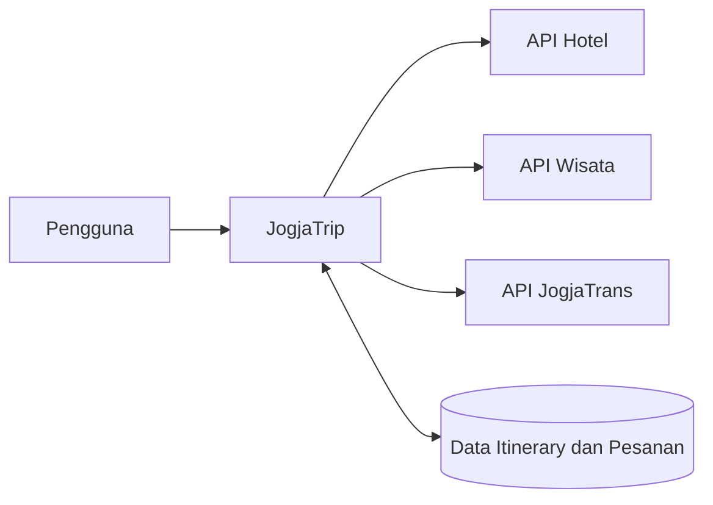

# JogjaTrip

**Platform Perencanaan Perjalanan Terintegrasi di Yogyakarta**

JogjaTrip merupakan aplikasi prototipe untuk mata kuliah **Interoperabilitas Lanjut**. Aplikasi ini menghubungkan layanan Hotel, Wisata, dan Transportasi melalui API sehingga pengguna dapat memilih layanan, menyusun itinerary, meninjau estimasi biaya, dan memantau informasi reservasi dalam satu antarmuka.

**[Kunjungi Website](https://jogjatrip-itinerary.azzahraghania110.workers.dev/)** · **[Dokumentasi Proyek](docs/README.md)** · **[Status Implementasi](docs/PROJECT_STATUS.md)**

> **Status:** JogjaTrip V5.3 telah berhasil di-deploy ke Cloudflare berdasarkan log Wrangler dan bukti tampilan website. Pengujian API publik serta penyimpanan D1 secara menyeluruh masih diperlukan. Checkout belum diaktifkan; sistem tidak menerima pembayaran nyata.

## Fitur Utama

- **Katalog Hotel, Wisata, dan Transportasi** dari layanan penyedia independen (rental JogjaTrans: harga simulasi).
- **Itinerary harian** dengan tanggal, jam pilihan pengguna, dan pemeriksaan konflik jadwal.
- **Rekomendasi destinasi** berdasarkan normalisasi wilayah administratif DIY.
- **Paket perjalanan** dengan komponen dan estimasi biaya berdasarkan pemeriksaan layanan.
- **Informasi pesanan** dan sinkronisasi status ketika data reservasi provider tersedia.

Jam kegiatan dalam itinerary merupakan **rencana pengguna**, bukan slot layanan yang telah dikonfirmasi. Integrasi rental JogjaTrans tersedia pada implementasi Workers JS sebagai katalog, quote, dan booking demo yang dikendalikan `BOOKING_ENABLED=false`.

## Arsitektur Singkat

JogjaTrip berperan sebagai **aggregator**. Data harga, ketersediaan, dan status pemesanan tetap mengikuti sistem masing-masing penyedia. Penyimpanan itinerary dan hubungan antarlayanan dikelola oleh JogjaTrip.

## Isi Repository

| Direktori atau berkas | Fungsi |
|---|---|
| `*.go` dan `go.mod` | Implementasi backend asli menggunakan Go 1.23 |
| `web/` | Tampilan aplikasi berbasis HTML, CSS, dan JavaScript |
| `ontology/` | Kosakata semantik serta pemetaan wilayah |
| `db/` | Skema penyimpanan untuk versi Go |
| `docs/` | Panduan penggunaan, arsitektur, API, dan deployment |
| `cloudflare/` | Backend Workers, D1, frontend, dan pengujian pada branch `cloudflare-deploy` |

Branch **`main`** mempertahankan aplikasi Go V5.3. Branch **`cloudflare-deploy`** berisi adaptasi Cloudflare Workers + D1 tanpa menghapus implementasi Go.

## Dokumentasi

| Panduan | Pembahasan |
|---|---|
| [Panduan Pengguna](docs/USER_GUIDE.md) | Alur penggunaan aplikasi |
| [Arsitektur](docs/ARCHITECTURE.md) | Integrasi dan interoperabilitas antarlayanan |
| [Referensi API](docs/API_REFERENCE.md) | Endpoint, parameter, dan status |
| [Pengembangan](docs/DEVELOPMENT.md) | Struktur kode, pengujian, dan Git |
| [Deployment Cloudflare](docs/DEPLOYMENT_CLOUDFLARE.md) | Pengaturan Worker dan database |
| [Checklist Verifikasi](docs/DEPLOYMENT_VERIFICATION.md) | Bukti yang diperlukan sebelum demonstrasi |
| [Status Proyek](docs/PROJECT_STATUS.md) | Capaian, pengujian, dan keterbatasan |
| [Riwayat Versi](docs/history/) | Changelog dan hasil pengujian sebelumnya |

---

**JogjaTrip V5.3 — Proyek Akademik Interoperabilitas Lanjut.**
