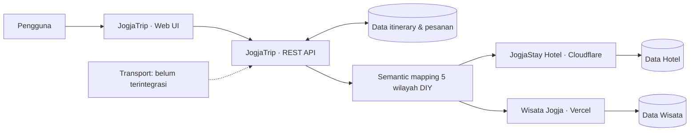

# JogjaTrip
### Integrated Travel Itinerary · Smart Bundling · Semantic Interoperability

**Platform perencanaan perjalanan Yogyakarta yang menghubungkan layanan Hotel dan Wisata independen melalui REST API.** Pengguna dapat mencari layanan, mengatur jadwal perjalanan sendiri, menyusun itinerary harian, melihat estimasi biaya, dan memantau referensi reservasi yang bersumber dari provider.

**Status proyek:** prototipe akademik *Interoperabilitas Lanjut* · **v5.3** · *pembayaran nyata belum tersedia*.

[**Panduan pengguna**](docs/USER_GUIDE.md) · [**Arsitektur**](docs/ARCHITECTURE.md) · [**API**](docs/API_REFERENCE.md) · [**Menjalankan & berkontribusi**](docs/DEVELOPMENT.md) · [**Deploy Cloudflare**](docs/DEPLOYMENT_CLOUDFLARE.md) · [**Status & batasan**](docs/PROJECT_STATUS.md)

---

## Mengapa JogjaTrip?

JogjaTrip bukan sekadar direktori tempat wisata atau kumpulan tautan reservasi. Aplikasi ini berperan sebagai **aggregator/interoperability layer**, sedangkan setiap sistem penyedia tetap memiliki data dan proses bisnisnya sendiri.

| Peran | Tanggung jawab | Sumber data |
|---|---|---|
| **JogjaTrip** | Paket, itinerary, waktu rencana pengguna, ringkasan pesanan dan status gabungan | Database JogjaTrip |
| **JogjaStay Hotel** | Hotel, kamar, harga, ketersediaan, dan status reservasi hotel | [Hotel Service](https://github.com/FaridAzis/jogjastay-hotel-service) |
| **Wisata Jogja** | Destinasi, tiket, harga, kuota, dan status pesanan wisata jika tersedia | [Wisata API](https://wisata-jogja-ten.vercel.app) |
| **Transportasi** | Integrasi direncanakan, **belum aktif** | Belum ada kontrak API yang terverifikasi |

### Fitur utama

- **Eksplorasi Hotel dan Wisata** dari katalog masing-masing penyedia, dengan pilihan wilayah DIY.
- **Pemesanan mandiri atau kombinasi layanan**: Hotel saja, Wisata saja, ataupun Hotel + Wisata.
- **Itinerary Builder**: agenda beberapa hari, jadwal hotel/wisata dan aktivitas pribadi, serta pengecekan benturan waktu.
- **Waktu fleksibel**: pengguna menentukan tanggal, jam mulai dan selesai. Jam ini adalah **preferensi itinerary**, bukan slot masuk yang dijamin oleh provider.
- **Rekomendasi berbasis semantik**: penyetaraan wilayah “Sleman” dan “kabupaten-sleman”, bukan klaim lokasi yang paling dekat secara geografis.
- **Smart Bundling**: contoh perjalanan bertema dan paket curated dengan perhitungan harga berdasarkan API ketika melakukan quote; diskon mengikuti aturan paket.
- **Booking Management**: kode pesanan, nama layanan apabila katalog tersedia, tipe kamar/tiket, harga historis, jadwal, kode reservasi provider, dan sinkronisasi status.
- **Toleransi kegagalan**: perbedaan status provider disimpan, dan kondisi parsial/unknown tidak dinyatakan sebagai transaksi berhasil sepenuhnya.

> **Penting:** membuat itinerary, memperoleh *quote*, membuat reservasi, dan menyelesaikan pembayaran adalah empat kejadian yang berbeda. Jangan menyamakan “PAID” pada simulasi provider dengan bukti pembayaran uang nyata.

## Arsitektur singkat



**Prinsip sumber kebenaran:** Hotel dan Wisata mengendalikan reservasi masing-masing. JogjaTrip menyimpan rencana serta referensi dan melakukan sinkronisasi; perubahan agenda tidak otomatis menjadwalkan ulang reservasi provider.

[Pelajari arsitektur, normalisasi wilayah, dan alur booking](docs/ARCHITECTURE.md).

## Struktur repository

```text
jogjatrip-itinerary/
├── README.md                    # Ringkasan dan navigasi proyek
├── docs/                        # Panduan, API, arsitektur, deployment
│   └── history/                 # Catatan versi dan hasil uji historis
├── main.go                      # Backend Go asli (stdlib)
├── integrated.go                # Itinerary dan rekomendasi Hotel–Wisata
├── packages.go                  # Paket curated, quote, booking
├── order_details.go             # Pengayaan rincian pesanan
├── v2.go / provider.go          # Model dan adapter pendukung
├── web/                         # Frontend HTML/CSS/JavaScript Go
├── data/packages/               # Template paket curated pada branch pengembangan
├── ontology/                    # Kosakata RDF/OWL/SKOS dan pemetaan wilayah
├── db/supabase.sql              # Skema penyimpanan Go dengan Supabase
└── cloudflare/                  # Target Workers + D1 (branch cloudflare-deploy)
    ├── src/                     # Handler dan adapter JavaScript
    ├── web/                     # Static assets
    ├── migrations/              # Skema D1
    ├── templates/               # Paket curated
    └── tests/                   # Unit dan mock API tests
```

**Ada dua jalur runtime:** branch `main` mempertahankan aplikasi **Go 1.23**; branch `cloudflare-deploy` menambahkan adaptasi **Cloudflare Workers + D1** dalam folder `cloudflare/`. Tidak perlu menulis ulang atau menghapus Go hanya untuk menyiapkan Cloudflare. Lihat [perbedaan dan status aktual](docs/PROJECT_STATUS.md).

## Memulai secara lokal

### Menjalankan versi Go

Prasyarat: **Go 1.23+**. Dari folder root repository:

```powershell
$env:HOTEL_API_URL="https://jogjastay-hotel-service.jogjawisata.workers.dev"
$env:WISATA_API_URL="https://wisata-jogja-ten.vercel.app"
go run .
```

Buka **http://localhost:8080**. Katalog dapat diakses selama API provider aktif; pembuatan booking memerlukan kredensial partner yang sah pada server. Jangan memasukkan token ke frontend atau repository.

```powershell
go vet ./...
go test -count=1 ./...
```

### Menjalankan versi Cloudflare

Ambil branch `cloudflare-deploy`. Prasyarat: **Node.js** dan akun Cloudflare untuk D1/Workers.

```powershell
git fetch origin
git switch --track origin/cloudflare-deploy
cd cloudflare
npm install
npm test
npx wrangler dev
```

Jika branch sudah tersedia secara lokal, gunakan `git switch cloudflare-deploy`. D1 lokal perlu migrasi sebelum fungsi penyimpanan digunakan. **BOOKING_ENABLED=false** secara default; fitur checkout penyedia belum siap diaktifkan untuk publik.

[Petunjuk lokal & Git](docs/DEVELOPMENT.md) · [Setup D1 dan GitHub auto-deploy](docs/DEPLOYMENT_CLOUDFLARE.md).

## Alur penggunaan

1. Tentukan tanggal, wilayah, jumlah orang, dan anggaran perjalanan.
2. Temukan hotel/kamar dan/atau tiket destinasi dari katalog penyedia.
3. Tentukan **tanggal dan jam rencana** setiap layanan. Beberapa wisata dapat dijadwalkan dalam satu hari jika memungkinkan.
4. Simpan ke **Pilihan Saya** atau susun **Itinerary** harian; pengguna juga dapat membuat agenda non-booking.
5. Gunakan **Periksa harga & ketersediaan**. Quote tidak menahan stok.
6. Apabila checkout telah diaktifkan dan teruji, JogjaTrip mengirim reservasi ke provider yang bersangkutan.
7. Pantau **Pesanan**: identitas layanan, detail kamar/tiket, referensi asli, harga dan status sinkronisasi. Jika provider gagal, lihat status terakhir beserta peringatannya.

[Langkah penggunaan lengkap dan contoh kasus](docs/USER_GUIDE.md).

## API dan semantik

Endpoint utama mencakup `GET /api/health`, `GET /api/catalog/{which}`, `GET /api/recommendations`, `POST /api/quote`, `POST /api/itineraries`, `GET /api/orders/{id}/details`, dan endpoint paket. Akses detail itinerary/pesanan memerlukan token pengguna terkait.

Dokumentasi kontrak: [API Reference](docs/API_REFERENCE.md). Kosakata: [`ontology/jogjatrip-core.ttl`](ontology/jogjatrip-core.ttl), dan [`ontology/region-mappings.json`](ontology/region-mappings.json). Implementasi mapping saat ini menggunakan aturan eksplisit di backend, **bukan OWL reasoner atau SPARQL endpoint**.

## Deployment, pengujian, dan keamanan

- **Go:** proses lokal atau hosting Go yang mendukung penyimpanan persisten; penyimpanan file lokal tidak cocok untuk filesystem serverless yang sementara.
- **Cloudflare:** Workers + D1; konfigurasi database pada `cloudflare/wrangler.jsonc` di branch `cloudflare-deploy` telah diisi UUID-nya, tetapi **itu bukan bukti database dapat diakses atau website sudah ter-deploy**.
- **CI:** `.github/workflows/ci.yml` pada branch pengembangan menguji Go, Node/mock, dan Wrangler *dry-run*. Uji produksi D1 dan booking provider adalah tahap terpisah.
- **Keamanan:** partner token hanya di environment server / Workers Secrets. Jangan commit `.env`, data pelanggan, atau kredensial. Kode ini adalah prototipe akademik, bukan sistem pembayaran riil.

**Status verifikasi terbaru:** [Project Status](docs/PROJECT_STATUS.md) · [Pengujian di GitHub](https://github.com/Sapexxx/jogjatrip-itinerary/actions) · [Pull Request Cloudflare](https://github.com/Sapexxx/jogjatrip-itinerary/pull/1).

## Dokumentasi lain

| Dokumen | Isi |
|---|---|
| [Dokumentasi lengkap](docs/README.md) | Daftar panduan dan catatan historis |
| [Panduan Pengguna](docs/USER_GUIDE.md) | Alur pengguna Hotel, Wisata, itinerary dan Pesanan |
| [Arsitektur](docs/ARCHITECTURE.md) | Source of truth, API adapter, semantic mapping |
| [API Reference](docs/API_REFERENCE.md) | Endpoint, autentikasi, payload |
| [Development Guide](docs/DEVELOPMENT.md) | Go, Workers, tes, Git workflow |
| [Cloudflare Deployment](docs/DEPLOYMENT_CLOUDFLARE.md) | D1, Worker, GitHub auto-deploy |
| [Status dan Batasan](docs/PROJECT_STATUS.md) | Terimplementasi, teruji, belum selesai |
| [Riwayat versi](docs/history/) | Changelog V4–V5.3 dan laporan pengujian |

---

**Dibangun untuk mata kuliah Interoperabilitas Lanjut.** Fokus utamanya adalah pertukaran data lintas aplikasi secara benar, terverifikasi, dan dapat dijelaskan—bukan mengklaim fitur yang belum didukung partner.
