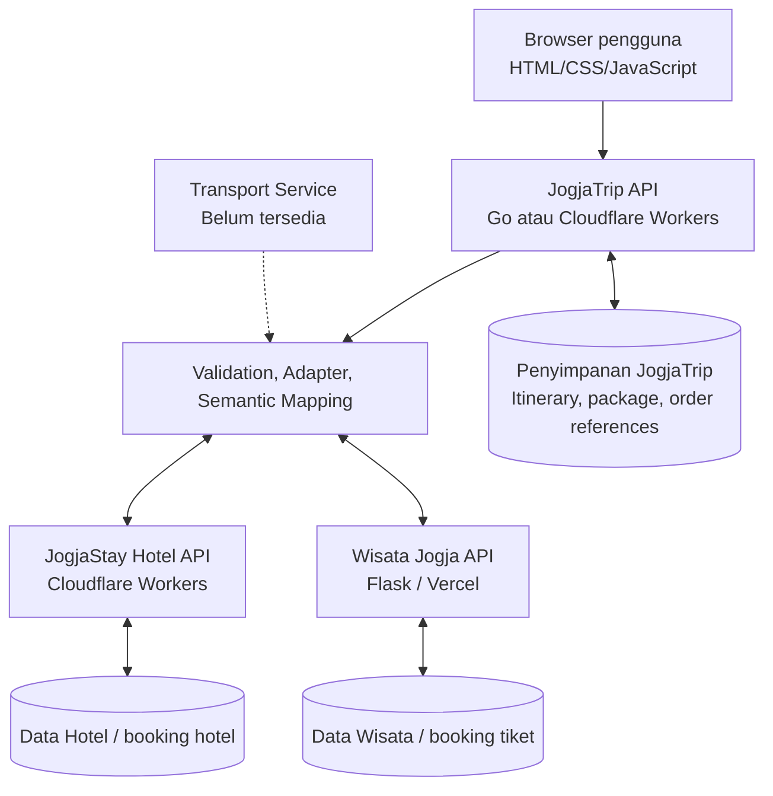
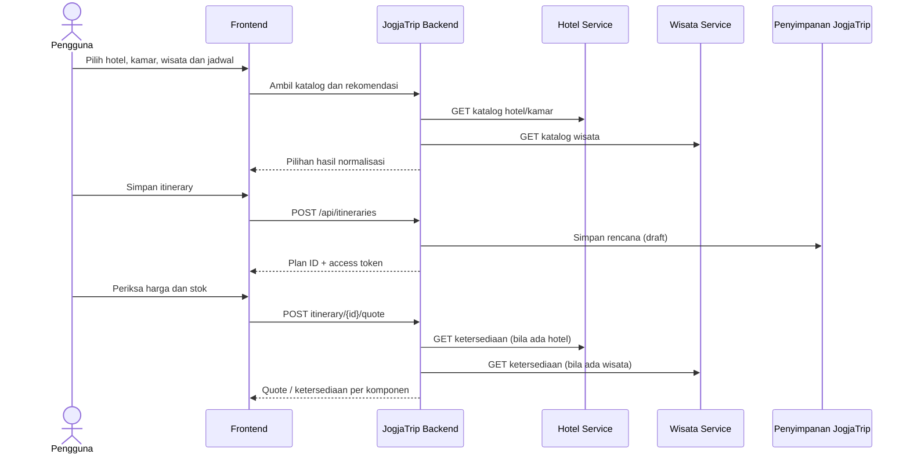

# Arsitektur dan Interoperabilitas JogjaTrip

## 1. Tujuan

JogjaTrip adalah **aggregator** perjalanan, bukan pengganti Hotel Service atau Wisata Service. Aplikasi menyediakan satu pengalaman lintas layanan sambil menjaga otoritas informasi masing-masing penyedia.



## 2. Pembagian tanggung jawab

| Domain | Sistem otoritatif | Catatan |
|---|---|---|
| Identitas hotel dan kamar | JogjaStay | JogjaTrip hanya mengonsumsi katalog |
| Harga hotel / kapasitas kamar | JogjaStay | Harus dicek pada tanggal yang dipilih |
| Destinasi / kuota dan harga tiket | Wisata Jogja | Harga per tiket tidak sama dengan tarif kamar per malam |
| Referensi reservasi / status mentah | Provider terkait | Booking Hotel dan Wisata disimpan terpisah |
| Jadwal yang dipilih pengguna | JogjaTrip | Preferensi, bukan konfirmasi slot jam |
| Paket dan aturan diskon bundle | JogjaTrip | Tidak mengubah harga dasar provider |
| Agenda, aktivitas pribadi, status gabungan | JogjaTrip | Berisi keterkaitan ID provider bila reservasi ada |
| Pembayaran riil | Tidak diimplementasikan | Label simulasi bukan tanda dana diterima |

## 3. Dua runtime dalam satu repository

**Go 1.23 pada branch main:** `net/http` menyajikan `web/`, adapter provider ada pada file Go; menyimpan order/itinerary ke file lokal untuk pengembangan atau Supabase bila konfigurasi lengkap.

**Cloudflare Workers pada branch cloudflare-deploy:** `cloudflare/src/index.js` adalah entry point, `cloudflare/web/` berisi static assets, D1 menyediakan tabel `jt_orders`, `jt_plans`, `jt_packages`. `BOOKING_ENABLED=false` menjadi pengaman default. Kode JS merupakan adaptasi independen dari Go, **bukan Go yang dikompilasi langsung menjadi Worker**.

Keduanya tidak seharusnya aktif mengelola transaksi produksi secara bersamaan tanpa strategi migrasi, penyatuan data, dan evaluasi risiko duplikasi.

## 4. Semantic interoperability

Penyedia dapat menggunakan label berbeda untuk konsep wilayah yang sama:

| Wilayah kanonis | Contoh label Hotel | Contoh kode Wisata |
|---|---|---|
| Kota Yogyakarta | Yogyakarta | kota-yogyakarta |
| Kabupaten Sleman | Sleman | kabupaten-sleman |
| Kabupaten Bantul | Bantul | kabupaten-bantul |
| Kabupaten Gunungkidul | Gunungkidul | kabupaten-gunungkidul |
| Kabupaten Kulon Progo | Kulon Progo | kabupaten-kulon-progo |

Normalisasi di backend menggunakan aturan eksplisit. Artefak [OWL/SKOS](../ontology/jogjatrip-core.ttl) mendeskripsikan konsep dan hubungan seperti `TravelPackage`, `Itinerary`, `Activity`, `Region`, `BookingReference` serta `hasActivity`, `activityInRegion`, dan `ownedByProvider`. **Belum ada SPARQL engine, triple store, ataupun OWL reasoner aktif.**

Penyetaraan *satu kabupaten* **tidak berarti** objek tersebut dekat, dapat dicapai cepat, atau memiliki jam buka yang sama. Untuk rekomendasi jarak dibutuhkan koordinat dan routing yang terverifikasi.

## 5. Alur permintaan dan quote



*Quote* adalah estimasi berdasarkan pemeriksaan saat itu; tidak membuat reservasi, tidak menahan stok, dan tidak membayar provider.

## 6. Booking, kegagalan, dan status

Ketika checkout secara eksplisit diaktifkan dan integrasi telah diuji, JogjaTrip mengirim reservasi dari backend server ke setiap provider. Data order dan referensi partner disimpan agar status dapat diperiksa kembali.

```text
Simpan rencana → Quote live → Validasi ulang → Persist order
            → Tandai komponen IN_FLIGHT sebelum request provider
            → POST booking ke provider → Simpan ID + status mentah
            → Sinkronisasi / hitung status agregat
```

Perlu dibedakan:

- `NOT_ATTEMPTED`: request booking belum dikirim.
- `PROCESSING / IN_FLIGHT`: sedang atau pernah dalam proses.
- `CONFIRMED`: status reservasi sudah dikonfirmasi menurut pemetaan status provider; bukan bukti pembayaran uang nyata.
- `PARTIAL`: ada komponen berhasil dan lainnya gagal/belum pasti.
- `FAILED / DECLINED`: kegagalan menurut hasil yang tersedia.
- `UNKNOWN`: respons timeout/tidak dapat dipastikan. **Jangan melakukan retry booking secara membabi buta.**

Status mentah seperti `PAID` (Wisata simulasi) atau `DECLINED` (Hotel) harus tetap tercatat. Penjadwalan ulang kegiatan pada itinerary tidak boleh diam-diam mengubah reservasi di provider. Refund dan kompensasi hanya dapat dilakukan sesuai operasi yang benar-benar tersedia pada partner; tidak ada transaksi lintas provider yang atomik.

**Batasan keamanan saat ini:** checkout langsung pada adaptasi Workers memerlukan perlindungan idempotensi dan rekonsiliasi lebih kuat sebelum dibuka untuk umum. Tetap gunakan `BOOKING_ENABLED=false`.

## 7. Akses dan keamanan data

- Browser menyimpan token akses order/itinerary untuk prototipe. Ini kurang cocok untuk perangkat bersama.
- Token partner berada pada backend dan disimpan sebagai variabel rahasia; jangan pernah dikirim ke JavaScript browser.
- Pemanggilan provider hanya dari server, menghindari eksposur token dan ketergantungan CORS langsung pada browser.
- Order, itinerary, dan referensi booking merupakan data sensitif. Jangan commit data pelanggan atau database lokal.
- Operasi berisiko (booking, sinkronisasi, kompensasi) memerlukan penyimpanan dan audit yang tahan restart.

Lanjutkan ke [API Reference](API_REFERENCE.md) dan [Status Implementasi](PROJECT_STATUS.md).
